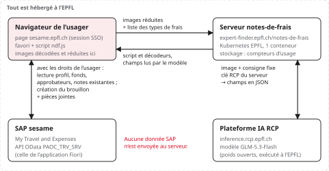

<!-- PDF : python docs/dossiers/build_dossiers.py (conventions de mise en page : docs/dossiers/README.md) -->

# Notes de frais automatiques

*Dossier de sécurité — demande d'avis de la cybersécurité EPFL avant un pilote*

|  |  |
|-------------|--------------------------------------------|
| **Responsable** | Yannick Pezeu |
| **Date, version** | 30.09.2026, version 1.0 |
| **Service** | https://expert-finder.epfl.ch/notes-de-frais |
| **Pour essayer** | Vous pouvez tester le service vous-même : ouvrez l'adresse ci-dessus, connectez-vous avec votre compte EPFL, puis saisissez le mot de passe de la phase de test, **communiqué dans le courriel d'envoi**. Installez le favori, ouvrez *My Travel and Expenses* dans sesame et cliquez dessus. La note est créée en brouillon dans votre propre sesame : vous pouvez la supprimer ensuite. Les compteurs d'usage sont visibles sur la page `/stats`. |
| **État** | Déployé ; accès par **connexion EPFL (Entra ID) et mot de passe de la phase de test** ; utilisé uniquement par l'équipe du projet. Aucun pilote avec des utilisateurs avant votre avis. |
| **Destinataire** | Cybersécurité EPFL (un dossier distinct est adressé à la DPO) |

## 1. En bref

L'outil remplit automatiquement une note de frais dans *My Travel and Expenses* (sesame.epfl.ch, SAP Fiori) à partir des photos ou PDF des justificatifs. Un modèle d'IA hébergé à l'EPFL (plateforme RCP) lit chaque justificatif ; l'usager vérifie un tableau ; la note est créée **en brouillon**, jamais soumise.

Techniquement, un **favori** (bookmarklet) charge un script depuis notre serveur dans la page sesame. Ce script agit dans SAP **avec la session et les droits de l'usager**, via l'API que l'application Fiori utilise elle-même.

> **Point principal (R1).** Le script servi s'exécute dans la session sesame de chaque usager qui clique sur le favori. Quiconque pouvant modifier ce script (serveur, image, registre, namespace Kubernetes) pourrait agir dans SAP au nom de ces usagers. Les autres risques sont secondaires. Les mesures actuelles et nos propositions sont au chapitre 4.

### Ce que nous vous demandons

1. Un avis sur le principe (script servi dans sesame par un favori) pour un **pilote restreint** avec quelques assistantes administratives.
2. Les mesures que vous exigez contre R1 avant ce pilote (revue de code, contrôle d'intégrité, restriction des droits de déploiement…).
3. Si le double verrou actuel convient pour le pilote : connexion EPFL (Entra ID), ouverte au personnel, **et** mot de passe de la phase de test, qui réserve l'accès aux testeurs. Le mot de passe sera retiré à votre feu vert.
4. S'il faut informer ou associer l'équipe SAP / VPSI, puisque l'outil utilise l'API de l'application Fiori.

## 2. Fonctionnement

1. L'usager ouvre sesame (connexion SSO EPFL habituelle), puis clique sur le favori « Note de frais ».
2. Le favori vérifie qu'il est bien sur sesame.epfl.ch, puis charge le script `ndf.js` depuis notre serveur. Si la personne n'est pas connectée, une petite fenêtre propose d'abord la connexion EPFL (puis, pendant la phase de test, un mot de passe) ; la session dure 12 heures.
3. Le script ouvre un panneau par-dessus la page et lit dans SAP, avec la session de l'usager, ce dont il a besoin : n° de personnel, types de frais autorisés, fonds, approbateurs, pays, et les notes existantes qui chevauchent le voyage (anti-doublon).
4. L'usager dépose ses justificatifs (photos, HEIC, TIFF, PDF). Ils sont décodés et réduits **dans le navigateur** (image JPEG de 1600 px au plus), puis envoyés à notre serveur. Un PDF de plusieurs pages est d'abord trié page par page (justificatif ou non, début de document) pour en séparer les justificatifs.
5. Le serveur ajoute une consigne fixe et la clé RCP, interroge le modèle sur la plateforme RCP de l'EPFL et renvoie les champs lus (date, montant, devise, fournisseur, type de frais, pays, ville).
6. L'usager relit et corrige le tableau, choisit fonds et approbateur, puis clique « Créer le brouillon ». Le script crée la note, joint les justificatifs et l'**enregistre en brouillon**. Il ne la soumet jamais : l'usager la relit dans sesame et clique lui-même sur Submit.

### Pourquoi un favori

SAP ne peut pas être appelé depuis un autre site (session SSO et règles CORS). Une extension de navigateur exigerait une installation par chaque personne, ce que le public visé ne peut pas faire. Le favori s'installe par glisser-déposer. Il fonctionne parce que sesame n'envoie pas d'en-tête `Content-Security-Policy` (constaté le 24.09.2026) : si SAP en ajoute une, l'outil cesse simplement de fonctionner, sans autre conséquence.

## 3. Composants et surface exposée

| Composant | Où il s'exécute | Rôle |
|------------|---------------|-----------------------------|
| **Favori** | Navigateur de l'usager | Quelques lignes : vérifie l'hôte sesame.epfl.ch, charge ndf.js. Ne contient aucun secret. |
| **Script ndf.js** | Page sesame.epfl.ch (servi par notre serveur) | ~1460 lignes, sans dépendance. Panneau (Shadow DOM), appels OData, préparation des images. |
| **Bibliothèques de décodage (tiers)** | Page sesame, chargées seulement si un fichier les requiert | pdf.js 6.3.289 (PDF), heic2any 0.0.4 (HEIC), UTIF 3.1.0 (TIFF). Servies par notre serveur, jamais par un CDN. |
| **Serveur** | Kubernetes EPFL, namespace epfl-chatbot, 1 pod | Node.js 22 sans dépendance npm (~790 lignes, connexion EPFL et compteurs d'usage compris). Image ic-registry.epfl.ch/mr-pezeu/notes-de-frais. |
| **Modèle** | Plateforme RCP de l'EPFL | GLM-5.3-Flash via inference.rcp.epfl.ch (API compatible OpenAI), clé d'application dédiée. |

| Point d'accès | Usage | Protection |
|----------|-----------------|------------------------------|
| **GET /** | Page d'installation du favori | Session EPFL et mot de passe (cookies) |
| **GET /login, /auth/callback** | Connexion EPFL (OpenID Connect) | Code d'autorisation + PKCE, state et nonce ; jeton d'identité vérifié |
| **POST /password** | Mot de passe de la phase de test | Seulement après la connexion EPFL, depuis nos pages ; 10 essais par 15 min, par IP et par personne |
| **POST /logout** | Fin de session | Depuis nos pages seulement (en-tête Origin) |
| **GET /ndf.js** | Script chargé par le favori | Session EPFL et mot de passe ; sinon, invitation à se connecter (sans le script) |
| **POST /extract** | Lecture d'un justificatif | Session EPFL et mot de passe (cookies), origine sesame, quotas par personne, validation des entrées |
| **POST /classify** | Tri des pages d'un PDF de plusieurs pages, avant lecture (voir ci-dessous) | Mêmes protections que /extract ; consigne fixe propre au tri |
| **GET /vendor/\*** | Bibliothèques open source | Public ; liste fermée de 4 fichiers relevée au démarrage |
| **GET /stats** | Compteurs d'usage (personnes au total, par mois et par jour ; appels ; jetons) | Session EPFL et mot de passe ; administrateurs seulement (liste fermée d'adresses) |
| **GET /healthz** | Sonde Kubernetes | Public ; ne renvoie que {ok} (non prêt si la configuration est incomplète) |

**Pourquoi trier les pages d'un PDF (`/classify`).** Un PDF de plusieurs pages peut réunir plusieurs justificatifs (une facture d'hôtel sur deux pages, des tickets de taxi scannés ensemble) et des pages sans intérêt (conditions générales, page blanche). Lu d'un bloc, il ne donnerait qu'une ligne, fausse. Le script envoie donc d'abord chaque page à `/classify` : le modèle dit si c'est un justificatif, son fournisseur, son n° de document et de page, et s'il commence un nouveau document. Le script regroupe ensuite les pages en justificatifs (même n° de document, « page 2/2 », page de suite) et écarte les autres ; chaque justificatif est alors lu par `/extract` et donne sa propre ligne de note. Un PDF d'une seule page n'est pas trié.

## 4. Analyse des risques

| # | Risque | Mesures en place | Risque résiduel et proposition |
|---|-------------|------------------|-----------------|
| R1 | **Code servi exécuté dans la session sesame.** Un script modifié pourrait lire ce que l'usager voit dans SAP, créer, modifier ou soumettre des notes en son nom. Impact élevé. | Hébergement sur l'infrastructure EPFL (cluster, registre). Aucune dépendance npm. Bibliothèques tierces figées par version, servies par notre serveur. Conteneur non-root, sans capacités, sans élévation de privilèges. Déploiement par une seule personne, après 45 tests automatisés. | **Moyen.** Proposé : revue du script par la cybersécurité ; déploiement d'une image épinglée par empreinte (digest) et historique des déploiements ; restriction des droits d'écriture sur le namespace. Option : le favori vérifie l'empreinte SHA-256 du script avant de l'exécuter (impose de réinstaller le favori à chaque version). |
| R2 | **Bibliothèques tierces** exécutées dans la page sesame, sur des fichiers déposés par l'usager. | Chargées seulement à la demande, et **vérifiées par empreinte SHA-256 avant d'être exécutées** : un fichier modifié est refusé. Versions, sources et procédure de mise à jour dans `web/vendor/README.md`. pdf.js : maintenu par Mozilla ; la faille d'exécution de code CVE-2024-4367 est corrigée depuis 4.2.67 et de toute façon neutralisée par `isEvalSupported: false` ; le rendu tourne dans un Web Worker. heic2any et UTIF sont évalués dans une portée isolée, sans variable globale. Les fichiers sont ceux de l'usager lui-même. | **Faible à moyen.** heic2any n'est plus maintenu depuis 2020. Proposé : veille de vulnérabilités ; remplacer heic2any ou réserver le HEIC à Safari, qui le lit sans bibliothèque. |
| R3 | **Justificatif piégé** (texte dans l'image cherchant à détourner le modèle). | Consigne fixe côté serveur. Le modèle n'a ni outil ni accès à SAP : sa réponse n'est qu'une proposition de champs, normalisés (type de frais filtré sur la liste SAP, montants numériques, dates ISO), affichés à l'usager qui valide. Brouillon uniquement. | **Faible.** Au pire des valeurs fausses, visibles à la relecture. |
| R4 | **Détournement du relais vers le modèle** (usage de notre clé RCP à d'autres fins). | Clé uniquement côté serveur (secret Kubernetes). Session EPFL exigée. Origine sesame vérifiée. Quotas : 60 appels/min et 1000/jour par personne. Consigne non modifiable ; aucun texte du client n'entre dans la consigne : des types de frais envoyés, le serveur ne garde que les identifiants qu'il connaît (liste des 50 types EPFL) et y met ses propres libellés. Taille des images et nombre d'appels simultanés bornés. Images : data URL JPEG/PNG/WebP de 6 Mo au plus. | **Faible.** Le relais ne sait que lire un justificatif ou trier une page. |
| R5 | **Contrôle d'accès** (qui peut utiliser le service). | Connexion EPFL : application Entra ID « notesDeFrais » (App Portal), OpenID Connect avec code d'autorisation, PKCE, state et nonce ; jeton d'identité vérifié (signature RS256 par les clés publiées d'Entra, relues toutes les 24 h ; émetteur, audience et azp, expiration, nonce, annuaire EPFL) ; portées limitées à openid, profile, email. Session : cookie signé (HMAC-SHA256), HttpOnly, Secure, SameSite=Lax, 12 heures ; rien n'est stocké côté serveur. Pendant la phase de test, mot de passe commun en plus, demandé seulement après la connexion EPFL, depuis nos pages (cookie de 30 jours **propre à chaque personne**, inutilisable dans la session d'une autre, 10 essais par 15 min, par IP et par personne). Sessions sans état : non révocables une à une, mais limitées à 12 heures ; changer le secret des sessions déconnecte tout le monde. Sans aucun verrou configuré, le serveur refuse tout. | **Faible.** L'application Entra est ouverte au personnel ; le mot de passe réserve la phase de test aux testeurs. Au feu vert : retrait du mot de passe, ou restriction de l'application Entra à un groupe pour le pilote. |
| R6 | **Action SAP non voulue** (mauvaise note, doublon). | Seulement l'API de l'application Fiori, avec les droits de l'usager. Enregistrement en brouillon, jamais de soumission. Anti-doublon : lecture des notes qui chevauchent le voyage, confirmation demandée. L'usager relit et soumet lui-même. | **Faible.** |
| R7 | **Données en transit et au repos** côté serveur. | HTTPS. Images en mémoire le temps de la requête, jamais écrites. Seule écriture : des compteurs d'usage, par jour (personnes distinctes et nouvelles, connexions, justificatifs lus, pages triées, erreurs, jetons envoyés et reçus) par mois (personnes distinctes et nouvelles) et au total (personnes depuis la mise en service) ; ni nom, ni heure, ni contenu (empreintes pseudonymisées, à clé fixe, pour compter les personnes au total, par mois et par jour ; voir le dossier protection des données). Fichier de quelques Ko sur un volume du cluster ; détail dans le dossier protection des données. Logs : les erreurs seulement (type d'appel, durée, message d'erreur), sans identité ni pseudonyme ; aucune ligne par appel réussi ni par connexion. | **Faible.** Détail dans le dossier protection des données. |
| R8 | **Indisponibilité.** | Un pod, ressources bornées (256 Mo, 0,5 CPU), sondes de santé. En cas de panne, l'usager saisit sa note à la main comme aujourd'hui. | **Faible.** |

## 5. Autres mesures techniques

- Panneau isolé dans un Shadow DOM : ses styles et son contenu ne se mêlent pas à ceux de la page sesame.
- Jeton CSRF de SAP lu à l'ouverture et renouvelé si SAP le refuse ; aucune donnée SAP écrite dans le navigateur hormis deux préférences (derniers fonds et approbateur choisis).
- Serveur : fichiers servis limités à une liste fermée ; en-tête `nosniff` ; page et script non mis en cache ; corps de requête limité à 9 Mo ; arrêt propre sur SIGTERM.
- Tests automatisés (45) exécutés avant chaque déploiement : calcul des montants, lecture des réponses SAP réelles anonymisées, regroupement des pages de PDF, validation des entrées du serveur, et connexion EPFL contre un faux Entra ID (PKCE, state, jetons à signature, émetteur, audience, date, nonce ou annuaire faux, session falsifiée ou expirée). Parcours complet vérifié dans Chrome : fenêtre de connexion ouverte depuis sesame, fermée d'elle-même, script chargé avec la session.

## 6. Bibliothèques tierces servies

Téléchargées depuis npm le 28.09.2026 et figées dans le dépôt ; déclarées dans `package.json` / `package-lock.json` pour être suivies par les scanners (OSV) et les alertes Dependabot de GitHub. Empreintes SHA-256 des fichiers servis, vérifiées par le navigateur avant exécution :

| Fichier | Version, licence | SHA-256 |
|-------------|-------------------|-------------------------|
| **pdf.min.mjs** | pdf.js 6.3.289 (build legacy), Apache-2.0 | `f401927e692efc7735e0cd528c490d0dd31b7f0972c122b7040df805be45cce4` |
| **pdf.worker.min.mjs** | pdf.js 6.3.289, Apache-2.0 | `a33cfe728c584fdba4fcc1fd54bcdc2f9f2f13889ddbb5b2bd1d0f8cbe49b84e` |
| **heic2any-0.0.4.min.js** | heic2any 0.0.4, MIT | `0963cfa50e9e1e7e6af929a40a81e3e898a673f1270eafa6917dd137e4968164` |
| **utif-3.1.0.js** | UTIF.js 3.1.0, MIT | `e3e76115f49571e39624c3316a76b3c4c5b2c5ca518dfec4b66a9f7af8c6d059` |

<small>Le code source complet (script, serveur, tests, manifestes Kubernetes) est disponible sur demande pour une revue.</small>

## Avis de la cybersécurité

- [ ] Favorable au pilote restreint, en l'état
- [ ] Favorable sous conditions (préciser ci-dessous)
- [ ] Défavorable
